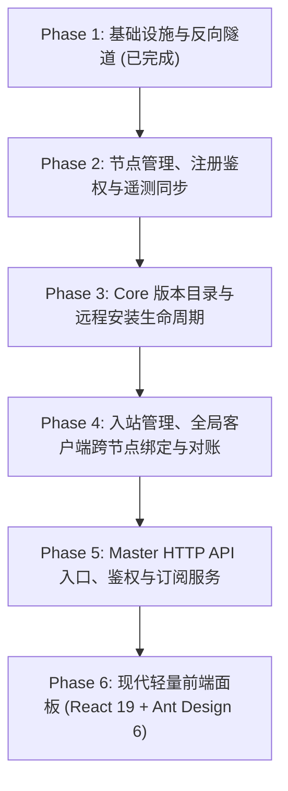

# MCUI 开发路线图与阶段规划

本文档按照模块间的**架构依赖关系**与**实现难易度（由底向上、先闭环后扩展）**编排重构后的 `mcui` 开发顺序。

## 总体设计原则

1. **双二进制极简拓扑**：全系统仅保留 `mcui-master`（控制面 + 内嵌前端 + 订阅服务）与 `mcui-agent`（无状态执行面）两个静态编译二进制。
2. **Agent 零监听端口**：Agent 通过出站 WebSocket 主动连接 Master，并在连接内升级 `hashicorp/yamux` 双向多路复用隧道；Agent 宿主机不额外暴露任何管理端口。
3. **默认零 Core、按需下发**：Agent 裸装启动时不包含任何代理内核；由 Master 下发指定版本的 Xray 安装指令后才拉取、校验并托管进程。
4. **集中式客户端模型**：对齐 `3x-ui` 多节点体验，`Client` 只在 Master 全局定义一次，通过 `ClientInbound` 多对多绑定任意节点的入站，统一汇总流量与生成聚合订阅。

---

## 阶段划分与依赖顺序

### Phase 1：基础设施与反向隧道（已完成）
- **复杂度**：⭐⭐
- **依赖**：无（最底层基础）
- **核心交付**：
  - `pkg/proto`：Master ↔ Agent 强类型通信协议与状态枚举。
  - `pkg/wsconn` + `internal/master/tunnel` + `internal/agent/tunnel`：WebSocket 转 `net.Conn` 适配器与 Yamux 双向 RPC 隧道。
  - `internal/master/db` + `internal/master/model`：纯 Go SQLite（`CGO_ENABLED=0`）GORM 数据模型。
  - `internal/agent/core/xray`：Xray 子进程守护、配置预检（`xray run -test`）、LKG 回滚与流量统计采集。

### Phase 2：节点管理、注册鉴权与遥测同步（当前阶段）
- **复杂度**：⭐⭐
- **依赖**：Phase 1（数据库模型 + Yamux 隧道）
- **核心交付**：
  - `NodeService`（`internal/master/service/node_service.go`）：
    - 节点 CRUD、生成一次性有效期注册令牌（`EnrollToken`）及一键安装脚本命令。
    - `Enroll`：校验并消费一次性令牌，签发持久化 `NodeToken`（数据库仅存 SHA-256 哈希）。
    - `AuthenticateNodeToken`：为 `/api/agent/tunnel` 握手提供高性能令牌校验。
    - `HandleAgentReport`：接收 Agent 每 4 秒上报的系统指标、Core 状态与用户/入站流量增量，更新节点快照并通过 WebSocket Hub 广播给前端。

### Phase 3：Core 版本目录与远程安装生命周期
- **复杂度**：⭐⭐⭐
- **依赖**：Phase 2（需要在线节点与状态回报链路）
- **核心交付**：
  - `CoreService`（`internal/master/service/core_service.go`）：
    - 拉取并缓存 `XTLS/Xray-core` 官方 GitHub Releases 稳定版本列表及各平台（`linux-amd64` / `linux-arm64`）压缩包下载地址与 SHA-256 摘要。
    - 向指定在线节点下发安装、升级、启停、卸载 Xray 指令，以及读取节点 Core 运行日志。

### Phase 4：入站管理、全局客户端跨节点绑定与状态对账
- **复杂度**：⭐⭐⭐⭐（核心业务层）
- **依赖**：Phase 3（节点已安装 Xray Core）
- **核心交付**：
  - `ReconcileService`：汇总某节点某 Core 下所有启用的 `Inbound` 及其绑定的活跃 `Client`（未禁用、未超额、未过期），组装 `DesiredCoreSpec` 推送给 Agent；若节点离线则标记 `ConfigDirty = true`，在节点重连时自动全量对账。
  - `InboundService`：入站 CRUD（VLESS / VMess / Trojan / Shadowsocks + Reality / TLS / WS / gRPC / XHTTP）、Reality 密钥对生成、端口冲突校验。
  - `ClientService`：全局客户端 CRUD、多节点入站绑定（`client_inbounds`）、流量清零、超额/到期自动停用并触发关联节点同步。

### Phase 5：Master HTTP API 入口、会话鉴权与订阅中心
- **复杂度**：⭐⭐⭐
- **依赖**：Phase 2 ~ Phase 4 全部 Service
- **核心交付**：
  - `AuthService` & Middleware：管理员登录、Cookie/Bearer 会话鉴权、密码修改。
  - REST API Server（`internal/master/server/` + `cmd/master/main.go`）：挂载管理 API、Agent 注册与隧道端点、前端实时 WebSocket、一键安装脚本生成端点（`/install-agent.sh`）以及内嵌静态前端资源。
  - `SubService`（`internal/master/sub/`）：按客户端 `SubID` 动态渲染多节点聚合订阅链接（通用 Base64 URI 列表与 Clash/Mihomo YAML）。

### Phase 6：现代轻量前端面板（React 19 + Ant Design 6）
- **复杂度**：⭐⭐⭐⭐
- **依赖**：Phase 5（REST API 与 WebSocket 事件流）
- **核心交付**：
  - 对标 `3x-ui` 最新技术栈（React 19 + Ant Design 6 + Vite + TanStack Query + TypeScript），支持亮/暗色主题切换。
  - 五大核心视图：**概览仪表盘**、**节点与内核插槽管理**、**入站管理**、**全局客户与多节点入站绑定**、**系统设置**。
